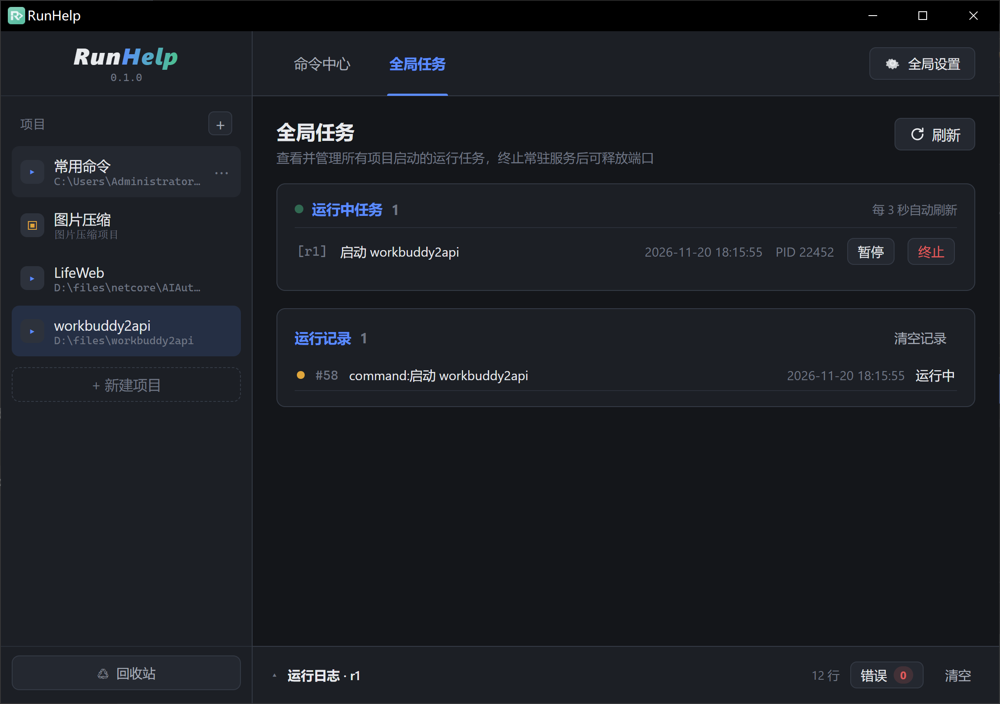
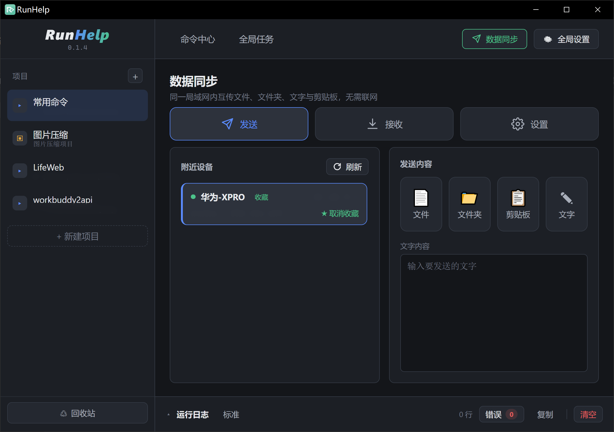
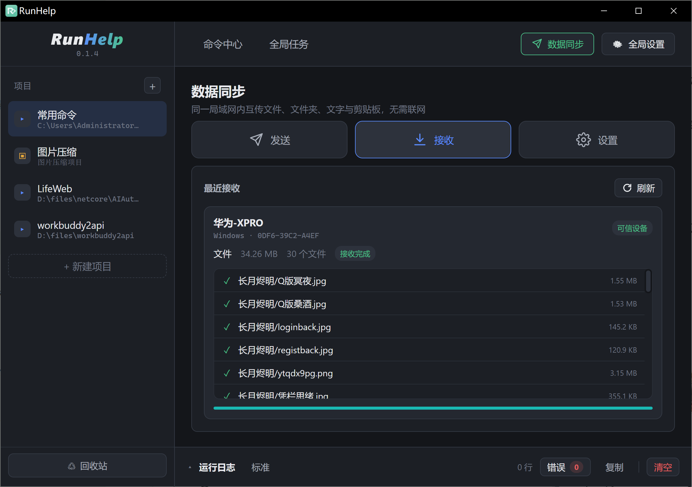
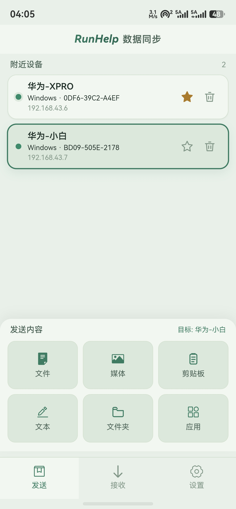
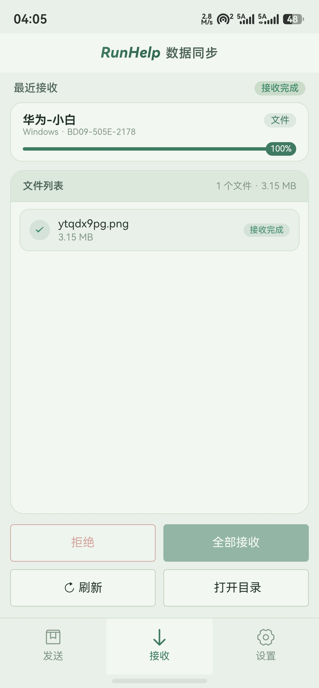

# RunHelp 开发助手

Windows 桌面端开发辅助工具：**轻便、快捷、内存占用低**。管理多个项目的常用命令、一键流水线、图片压缩，支持局域网设备间加密直传文件 / 文件夹 / 文字 / 剪贴板，数据全部存于本地 SQLite。

另提供 **Android 版**：与电脑在同一局域网内直传文件 / 文件夹 / 图片视频 / 应用 / 文字 / 剪贴板，和桌面端完全互通。手机端为触屏重排的独立界面（发送 / 接收 / 设置三页），支持相册图片视频混选、应用安装包导出、收到文件落到「下载/RunHelp」或在文件管理器里一键打开。

技术栈：Tauri 2 + Vue 3 + TypeScript（前端）+ Rust（后端）+ SQLite（rusqlite，单文件），桌面与 Android 共用同一套代码与同步协议。

## 亮点

- **轻便**：基于 Tauri 2，复用系统自带 WebView2，不捆绑浏览器内核，安装包小巧
- **快捷**：秒级冷启动，命令与流水线一键运行，日志实时回显，无需等待
- **低内存占用**：Rust 原生后端 + 系统 WebView，常驻内存远低于 Electron 类应用
- **数据本地化**：单文件 SQLite，无需数据库服务与云端账号，所有数据留在自己电脑
- **局域网直传**：同一局域网内设备之间互传文件 / 文件夹 / 文字 / 剪贴板，电脑与电脑、手机与电脑均可，mTLS 加密、指纹确认设备身份，不经云端、无需联网
- **手机端互通**：Android 版与桌面端同一协议，手机可发相册图片视频、应用安装包，收到文件自动落到「下载/RunHelp」，秒级识别设备上下线
- **中英双语**：界面文案与运行提示一键切换简体中文 / English，默认中文，即时生效无需重启
- **完成提醒**：任务成功且窗口不在前台时弹 Windows 系统通知，前台操作不打扰
- **开源免费**：MIT 协议，无广告、无订阅、无需注册，可自由使用与修改

## 功能

- **项目管理**：先选类型再新建（开发项目必填路径，图片压缩项目免路径）；页签按类型显示（开发只显示命令中心，图片压缩只显示图片压缩）；删除进回收站，可还原/彻底删除/清空
- **命令中心**：为每个项目添加安装、构建、运行或自定义命令，可选 Shell（PowerShell / CMD / Git Bash）、工作目录、超时
- **流水线**：把多个命令与"等待"步骤串成一键操作，支持失败即停/继续、暂停/继续/终止
- **实时日志**：底部运行日志默认收缩，点标题栏即可展开；支持「只看错误」筛选并显示错误条数；运行中状态会被准确区分（成功/失败/超时/已停止）；新日志自动滚到底部，手动上滑查看历史时暂停跟随并显示「跳到最新」未读提示；标题栏可切换「标准 / 半屏 / 全屏」三档高度，顶边可拖拽微调，位置自动记住
- **图片压缩**：可调质量/尺寸/格式/命名/元数据等参数并保存为预设；每个预设可指定"使用脚本"；选择文件或目录后一键调用 Python 脚本批量压缩，显示进度与节省空间；支持收藏常用目录
- **脚本管理**：Python 脚本源码可存入数据库（带版本号），也可外链本地 `.py` 文件；在图片压缩预设里选择后生效
- **备份与恢复**：内置备份脚本，设置页一键备份到指定目录；恢复前自动另存一份保命备份，恢复后用旧版备份也能自动升级表结构、立即生效
- **数据同步**：右上角「数据同步」进入，三视图（发送 / 接收 / 设置）。自动发现同一局域网设备，收藏常用设备；可发送文件、文件夹、文字或剪贴板内容，接收方先核对设备指纹、按清单选择要收的文件，逐文件显示实时进度，支持取消发送与拒绝。有人发来数据时自动把窗口置前并切到同步页（可关闭）。全程 mTLS 加密，只在两台设备之间直传，不经过任何服务器
- **任务完成通知**：命令 / 流水线 / 图片压缩 / 数据库备份成功后，若窗口不在前台则弹系统通知；设置页可关闭，失败与手动终止不打扰
- **Android 手机端**：发送页发现附近设备，可发文件、相册图片视频（应用内网格多选，支持按日期分组与类型筛选）、应用安装包、文件夹、文字、剪贴板；接收页核对来源设备后接收，逐文件显示进度，支持部分接收与直接打开保存目录；前台服务保活，退到后台仍能收；收到文件落盘到「下载/RunHelp」或自选文件夹
- **主题**：深色 / 浅色切换，原生标题栏跟随主题
- **语言**：简体中文 / English 切换，界面与运行提示同步生效
- **单实例**：重复点击图标只激活已有窗口，不会开多个实例

> 数据库结构采用版本化迁移（`user_version` + 事务 + 迁移前自动备份）：软件升级后首次启动会自动补齐新表 / 新列，无需手动处理；迁移均为加列 / 建索引等轻量操作，数据量大也不会因行数多而失败。

## 界面预览

**命令中心**：按项目组织安装 / 构建 / 运行命令，底部运行日志默认折叠、可展开，支持只看错误


**图片压缩**：参数预设 + 内置压缩脚本，支持常用目录收藏与进度显示


**全局任务**：跨项目查看运行中任务，可暂停 / 终止常驻服务，并保留运行记录



**数据同步 · 发送**：发现局域网设备、收藏常用设备，选择文件 / 文件夹 / 文字 / 剪贴板发送



**数据同步 · 接收**：查看最近一次接收任务的文件清单与实时进度，支持部分接收



### 手机端（Android）

**发送**：自动发现局域网内的电脑，选中目标后一键发送文件 / 图片视频 / 应用 / 剪贴板 / 文字 / 文件夹



**接收**：核对来源设备后接收，逐文件显示进度，接收完可在应用内直接看收到什么、打开保存目录



## 下载安装

- **GitCode（主仓，国内推荐）**：`https://gitcode.com/binglengdexie/RunHelp/releases`
- **GitHub 镜像**：`https://github.com/553576267/RunHelp/releases`
- **Gitee 镜像**：`https://gitee.com/binglengdexie/RunHelp/releases`

下载 `RunHelp_x.x.x_x64-setup.exe` 直接安装即可。三个仓库内容一致：**GitCode 是主仓**，日常开发只推 GitCode；GitHub 与 Gitee 由 GitCode 内置的「仓库镜像 → Push」单向自动同步，仅作为其他地区的访问入口。

**Android 版**：下载 `RunHelp-vX.Y.Z-android-arm64-signed.apk`（arm64 设备，Android 8.0+），传到手机上直接安装。安装包已用固定证书签名，后续版本可直接覆盖升级，无需卸载。手机与电脑需连同一个局域网（同一 WiFi，或手机开热点给电脑连）。

## 开发

前置要求：Node 22+、Rust（MSVC 或 GNU 工具链均可）、对应平台的 C++ 链接器（Windows 上 MSVC 需 Windows SDK，或改用 GNU + MinGW-w64）、Python 3（仅压缩功能需要）。

```bash
npm install                 # 安装前端依赖
npm run tauri dev           # 开发模式运行
npm run build               # 仅构建前端（含类型检查）
npm run tauri build         # 打包 MSI/NSIS 安装包
```

图标由 `scripts/gen_icons.py` 生成（纯标准库）。

**Android 打包**（需 JDK 17+、Android SDK、NDK 27，并用真 node 调用 Tauri CLI）：

```bash
node node_modules/@tauri-apps/cli/tauri.js android build --apk --target aarch64
# 产物：src-tauri/gen/android/app/build/outputs/apk/universal/release/app-universal-release.apk
```

签名配置在 `src-tauri/gen/android/keystore.properties`（不入库），release 构建会自动签名。手机端界面在 `src/components/SyncViewMobile.vue` 与 `src/components/mobile/`，桌面端与移动端由 `app_is_mobile` 在 `src/main.ts` 分流，桌面专属 API 全部用 `#[cfg(desktop)]` 隔离。

## 图片压缩脚本

内置脚本 `scripts/compress_images.py` 基于 Pillow，运行时由 Rust 端写入临时目录并以 JSON 配置调用：

```bash
pip install Pillow
python compress_images.py --config config.json
```

脚本按行输出 JSON（`progress` / `result` / `error` / `summary`），App 解析后更新进度条与结果列表。脚本内置到 `scripts` 表，用户可在"全局设置 → 脚本管理"里修改源码（修改后版本号 +1）。

**自定义脚本的使用流程**：全局设置 → 脚本管理 → 新建脚本（存入数据库或外链 `.py`）→ 图片压缩页 → 参数预设的"使用脚本"下拉选中它 → 保存预设 → 开始压缩。自定义脚本需遵循内置脚本的协议：读取 `--config` 指向的 JSON（含 `input_paths` 与各项参数），按行输出 `progress`/`result`/`summary`/`error` JSON。

## 数据库位置与备份

默认数据库在 `%APPDATA%\com.runhelp.desktop\runhelp.db`，「全局设置 → 数据库位置」只读显示当前库文件与所在目录。全部项目、命令、脚本、预设与运行记录都在这一个文件里。

**跨设备传文件**：用右上角的「数据同步」在同一局域网内两台电脑之间直传文件 / 文件夹 / 文字 / 剪贴板，mTLS 加密、指纹确认设备身份，无需联网也不经过第三方服务器。设备名在同步页独立设置，不影响项目名与备份前缀。

**跨设备迁移数据库**：采用「本地库 + 备份文件」方案，不要把数据库本体放进坚果云 / OneDrive 等同步盘（多端同时写会导致损坏）。推荐做法：

- 在「全局设置 → 备份与恢复」把备份目录设为同步盘的某个文件夹，点「立即备份」生成带机器名和时间戳的备份。
- 另一台电脑从同步盘取备份，在同一页面点「恢复」；恢复前会自动把当前库另存为 `.before-restore_时间戳.db`，恢复后自动对齐到当前表结构、立即生效，无需重启。
- 备份脚本内置在数据库中（也可在 `scripts/backup_db.py` 查看源码），使用 SQLite backup API 热备份，无需退出软件，备份后自动切回 DELETE 模式并校验完整性。

> 直接用软件内的「立即备份」/「恢复」即可，脚本会处理好 `-wal`/`-shm` 附属文件与表结构升级；不要手工替换数据库文件后期望旧结构自动生效。

## Windows 工具链说明

优先用 **MSVC 工具链**（`rustup default stable-x86_64-pc-windows-msvc`），需安装 Visual Studio Build Tools + Windows SDK。GitHub Actions 的打包环境就是 MSVC，无需额外配置。

如果本机没有 Windows SDK，MSVC 会在链接阶段报 `link.exe failed` / `extra operand`，此时可改用 **Rust GNU 工具链 + MSYS2 的 MinGW-w64**（本项目开发机实测通过）：

**1. 安装 MinGW-w64**（假设 MSYS2 装在 `<MSYS2 安装目录>`， pacman 建议换国内源）：
```bash
<MSYS2 安装目录>\usr\bin\bash.exe -lc "pacman -S --noconfirm mingw-w64-x86_64-gcc"
# 装完验证：gcc -dumpmachine 应输出 x86_64-w64-mingw32
```

**2. 安装 Rust GNU 工具链**（必须一次装完整，中途中断会留下缺 manifest 的空壳，导致 `rustc -vV` 失败）：
```bash
rustup toolchain install stable-x86_64-pc-windows-gnu --profile minimal --force
rustup default stable-x86_64-pc-windows-gnu
```

**3. 编译时把 MinGW 的 bin 注入 PATH**（无需改系统 PATH，`<MSYS2 安装目录>` 在 Git Bash 下写成 `/d/xxx/msys64` 这类 POSIX 路径）：
```bash
export PATH="/path/to/msys64/mingw64/bin:$HOME/.cargo/bin:$PATH"
npm run tauri dev      # 或 npm run tauri build
```

> 注意：国内网络下 `npm` 源可用 `https://registry.npmmirror.com`，旧的 `registry.npm.taobao.org` 已废弃会导致安装卡死。

## 目录结构

```
src/                      Vue 前端
  components/             各功能组件
  components/mobile/      手机端专用组件（接收面板 / 发送状态 / 媒体与应用选择 / 接收目录）
  lib/api.ts              Tauri invoke 封装（参数名与 Rust 端严格一致）
  lib/i18n.ts             前端中英文字典（t / setLocale，key 为中文原文）
src-tauri/                Rust 后端
  src/commands/           各业务命令（project/command/pipeline/script/settings/compress）
  src/sync/               数据同步：设备发现、mTLS 传输、身份证书、IPC 命令与事件
  src/mobile.rs           Android 专属桥接（相册、应用、目录、前台服务）
  src/platform/           平台适配层（Shell / 路径 / 外部程序调用）
  src/process.rs          进程 spawn、实时日志、终止进程树、暂停等待
  src/state.rs            全局运行时状态（pid 表、暂停标志）
  src/db.rs               数据库版本化迁移（user_version + 事务 + 迁移前备份）与内置脚本播种
  src/i18n.rs             后端提示字典（tr / trf，语言取自 settings.language）
  gen/android/            Android 工程与自定义插件 RunhelpMobilePlugin.kt
migrations/               版本化建表与迁移（当前 user_version=5，含同步设备与指纹）
scripts/                  Python 压缩 / 备份脚本、图标生成脚本
docs/screenshots/         README 界面截图
docs/assets/              README 用到的其它图片（赞赏码）
```

## 命令执行的设计要点（踩坑记录）

Windows GUI 应用里"跑命令"有几个非常隐蔽的坑，本项目的实现参考了同类开源项目
`ocampoje17/projects-runner-app`（同为 Tauri 2），以下几条务必保持：

1. **输出必须按字节容错解码，不能用 `BufReader::lines()`**。
   `lines()` 要求严格 UTF-8，遇到非法字节（如中文控制台的 GBK 字节、被 read 边界切断的
   多字节字符）会返回 `Err`，旧代码直接 `break`，导致整段 stdout/stderr 被吞——表现为
   "命令失败了但控制台什么错误都没有"。现在 `process.rs` 里的 `Utf8StreamDecoder` 逐段解码，
   坏字节替换为 `U+FFFD` 后继续，永不中断；同时给 Python 子进程加 `PYTHONIOENCODING=utf-8`，
   从源头保证管道输出是 UTF-8。

2. **启动时要修复 PATH**。Windows 下 GUI 程序从资源管理器/其他程序启动时，
   `std::process::Command` 继承的 PATH 可能是陈旧快照。`lib.rs` 的 `run()` 开头把 PATH
   读出再 `set_var` 写回，强制刷新（等价于官方 `fix-path-env` crate）。

3. **不要裸用 `python`，要显式指定解释器**。系统里常有 WorkBuddy/WindowsApps 注入的
   `python` 抢占 PATH（表现为 `No module named 'fastapi'`）。设置页的"Python 解释器路径"
   会把该解释器目录前置到子进程 PATH。`python_path`、`PYTHONUNBUFFERED`、
   `PYTHONIOENCODING` 三者配合，才能既用对环境、又实时看到中文日志。

4. **日志可能被事件时序丢掉**。秒退进程的流式日志可能晚于前端的"清空日志"动作。
   现在后端在 `run://end` 事件里附带完整 stderr 全文，前端据此兜底补齐（自动去重）。

5. **子进程要加 `CREATE_NO_WINDOW`**。Windows 下 GUI 程序 spawn cmd/powershell 会弹黑窗口，
   用户关掉它等于给进程组发 `CTRL_CLOSE`，把常驻的 python 服务一起杀掉（退出码
   `-1073741510`）。`process.rs` 的 `execute()` 用 `CommandExt::creation_flags` 加了
   `CREATE_NO_WINDOW`，子进程静默运行，stdout/stderr 仍走管道捕获。

6. **区分"停止"与"失败"**。用户主动终止（点"终止"按钮或关窗口导致的 `-1073741510`）
   应记为 `stopped`（显示"已停止"），而不是 `failed`。`AppState.runtime` 里维护
   `run_id -> history_id` 映射和"主动终止集合"；应用启动时把遗留的 `running` 记录
   统一收尾为 `stopped`（清理僵尸记录）；应用退出时 kill 所有 tracked 子进程，
   避免服务残留占用端口。

> 提示：常驻服务（如 `python server.py`）的命令类型应选"运行"，超时设 `0`（不限），
> 否则到点会被强制终止（退出码 124）。运行后软件会一直显示"运行中"，需要结束时
> 点"终止"按钮——这是正常行为，不是卡住。

## 开源协议

MIT License，详见 [LICENSE](LICENSE)。可自由使用、修改、商用，无需付费，但需保留版权声明。

## 贡献

欢迎提交 Issue 与 Pull Request，流程见 [CONTRIBUTING.md](CONTRIBUTING.md)。

更新记录见 [CHANGELOG.md](CHANGELOG.md)。

## 赞赏

如果 RunHelp 对你有帮助，欢迎自愿赞赏支持作者维护项目。

<p align="center">
  
</p>

赞赏为无偿赠与，不构成任何服务购买或软件授权。感谢每一份心意。
